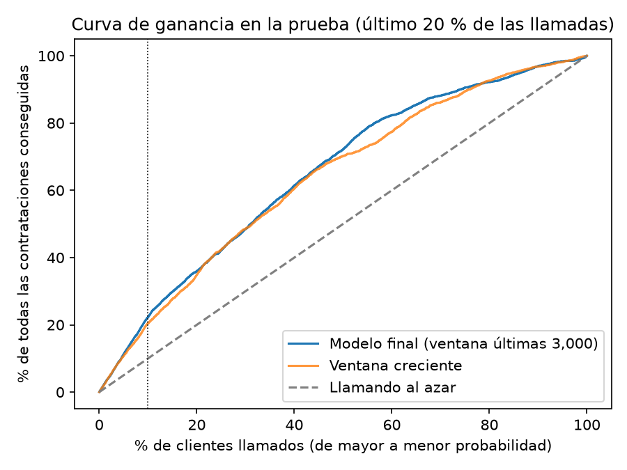
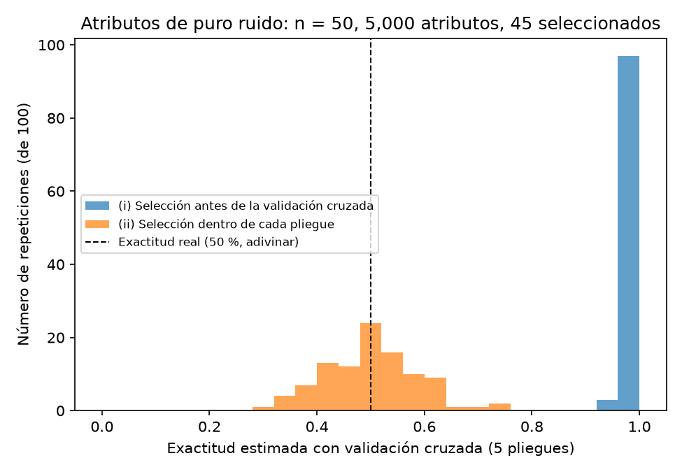

# Problema 1: El reporte demasiado bueno

**Owen Adiel Solis Zatarain** · Expediente `223201053` · $a = 3$, $b = 5$ · semilla `223201053`

Con estos parámetros, la versión personal del código de la consultora usa:
- $k = 10 + a = 13$ atributos en `SelectKBest`;
- `LogisticRegression(C=c, max_iter=2000)` con $c \in \{0.01, 0.1, 1, 10\}$, porque $b \bmod 3 = 2$;
- $20 + 5b = 45$ atributos seleccionados en el experimento del ruido.

Todo el código está en [`problema_1.ipynb`](problema_1.ipynb). Los datos (*Bank Marketing*, UCI) se descargan desde el propio notebook y no se guardan en el repositorio.

## Cómo reproducir

Desde la raíz del repositorio, con [uv](https://docs.astral.sh/uv/) instalado:

```bash
uv sync
uv run --with jupyter jupyter nbconvert --to notebook --execute --inplace problema-1/problema_1.ipynb
```

El segundo comando ejecuta el notebook completo (unos 1–2 minutos, más la descarga de los datos) y guarda las gráficas en `problema-1/figuras/`. También se puede abrir el notebook en VS Code o Jupyter con el kernel de `.venv` y usar *Run All*.

## (a) Reproducción

| Versión | C elegido | Exactitud | AUC |
| :--- | :---: | :---: | :---: |
| Código de la consultora con mis parámetros | 10 | 0.807 | 0.893 |

## (b)–(c) Problemas encontrados y efecto de cada uno

Cada variante corrige **un solo** problema y deja los demás como en el código original:

| Variante | Tipo de problema | Exactitud | AUC | % positivos en prueba | Exactitud trivial |
| :--- | :--- | :---: | :---: | :---: | :---: |
| 0. Original | — | 0.807 | 0.893 | 48.2 | 0.518 |
| 1a. Sin `duration` | Fuga de información | 0.689 | 0.750 | 48.2 | 0.518 |
| 1b. Sin `duration`, `campaign`, `day`, `month` | Fuga de información | 0.671 | 0.734 | 48.2 | 0.518 |
| 2. Copias de positivos solo en entrenamiento | Fuga (copias en la prueba) | 0.848 | 0.896 | 12.3 | 0.877 |
| 3. Escalado ajustado solo con entrenamiento | Fuga en el preprocesamiento | 0.807 | 0.893 | 48.2 | 0.518 |
| 4. Selección de atributos solo con entrenamiento | Fuga supervisada | 0.807 | 0.893 | 48.2 | 0.518 |
| 5. Partición cronológica | Mala práctica de validación | 0.699 | 0.680 | 87.3 | 0.873 |
| 6. `C` elegido con validación cruzada | Mala práctica de validación | 0.807 | 0.893 | 48.2 | 0.518 |
| Todos corregidos | — | 0.710 | 0.713 | 31.6 | 0.684 |

**Conclusiones.**
- La exactitud no se puede comparar entre variantes porque la proporción de positivos cambia. Por eso comparamos con el AUC, y cada exactitud solo contra la *exactitud trivial* de su fila.
- Lo que más pesa es la **partición cronológica** (el AUC baja a 0.680), seguida de **`duration`** (0.750).
- Las correcciones 3, 4 y 6 no cambian nada: con unos 77 mil renglones, incluir la prueba casi no mueve la media, la desviación ni las F, y elegir entre 4 valores de `C` con unos 15 mil datos de prueba da un sesgo de ~0.5 %.
- Las copias casi no cambian el AUC (0.896), al contrario de lo que predice la fórmula de la teoría (a). Esa fórmula supone que el modelo memoriza las copias, y una regresión logística, con 13 coeficientes, no puede hacerlo.

## (d) La versión honesta

**Decisiones:**
- **Partición:** cronológica; el último 20 % de las llamadas es la prueba.
- **Variables:** sin `duration`, `campaign`, `day` ni `month`.
- **Preprocesamiento:** escalado, one-hot y `SelectKBest` dentro de un `Pipeline`.
- **Hiperparámetros:** elegidos con `TimeSeriesSplit` en el entrenamiento: `C`, `class_weight` (ninguno o `balanced`) y el tamaño de la ventana de entrenamiento (creciente o las últimas 3,000, 6,000, 12,000 o 18,000 llamadas).
- **Métrica principal:** la precisión en el 10 % superior, que corresponde al uso del banco (llamar primero a los de mayor probabilidad).

La validación cruzada eligió la ventana de las **últimas 3,000 llamadas** con `class_weight="balanced"` y `C = 1`. El modelo se evaluó una sola vez en la prueba (9,043 llamadas, tasa base de 31.6 %), con IC 95 % por bootstrap (1,000 remuestreos):

| Métrica | Valor | IC 95 % |
| :--- | :---: | :---: |
| Precisión en el 10 % superior | 0.702 | 0.675 – 0.732 |
| Lift (veces la tasa base) | 2.22 | 2.14 – 2.32 |
| AUC-PR | 0.540 | 0.521 – 0.559 |
| AUC-ROC | 0.722 | 0.711 – 0.733 |

Como diagnóstico, que no se usó para elegir, la ventana de 3,000 supera a la creciente por **+6.0 puntos** de precisión en el 10 % superior (IC 95 % por bootstrap pareado: [+3.3, +9.1]). Esto confirma la hipótesis de la ventana deslizante de la teoría (e): la tasa de contratación cambia mucho con el tiempo (de ~3 % a ~47 %), y las llamadas viejas se parecen poco a la siguiente campaña. En cambio, balancear o no casi no importa: en la validación cruzada las dos opciones quedan empatadas, porque el modelo se usa para ordenar y no para cortar en 0.5.



**La gráfica:** si el banco llama a los clientes en el orden que da el modelo, la curva queda siempre arriba de la línea del azar. Con el 10 % de las llamadas consigue el 22 % de todas las contrataciones, contra el 10 % llamando al azar. La ventana deslizante mejora sobre todo en la zona del 10–20 %, que es donde el banco concentraría sus llamadas.

## (e) El experimento del ruido

Hicimos 100 repeticiones con $n = 50$ datos (25 de cada clase) y 5,000 atributos de ruido. En cada una se eligen 45 atributos con `SelectKBest(f_classif)` y se estima la exactitud de una regresión logística con validación cruzada de 5 pliegues.

| | (i) Selección antes | (ii) Selección dentro |
| :--- | :---: | :---: |
| Media | 0.991 | 0.494 |
| Desv. est. | 0.014 | 0.087 |
| Mín – máx | 0.94 – 1.00 | 0.30 – 0.74 |



**Conclusión.** Si se seleccionan los atributos con todos los datos antes de la validación cruzada, un clasificador que en realidad adivina (50 %) parece casi perfecto (99 %). Los pliegues de validación ya participaron en la elección de los atributos, y las correlaciones casuales del ruido quedan "copiadas" en ellos. Con la selección dentro de cada pliegue, el resultado regresa a ~50 %. La mayor correlación medida entre un atributo y la clase fue de 0.516, algo menor que la estimación de 0.58–0.61 de la teoría (c), porque la propiedad (P1) es asintótica y sobreestima el máximo para $m$ finito.
