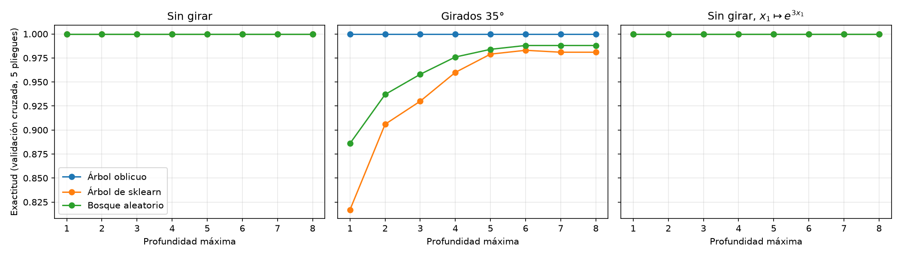
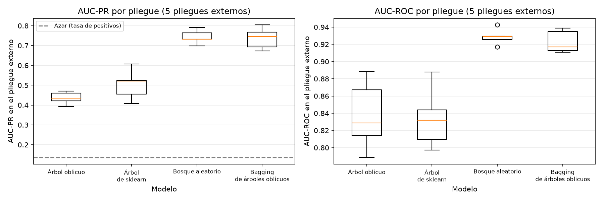
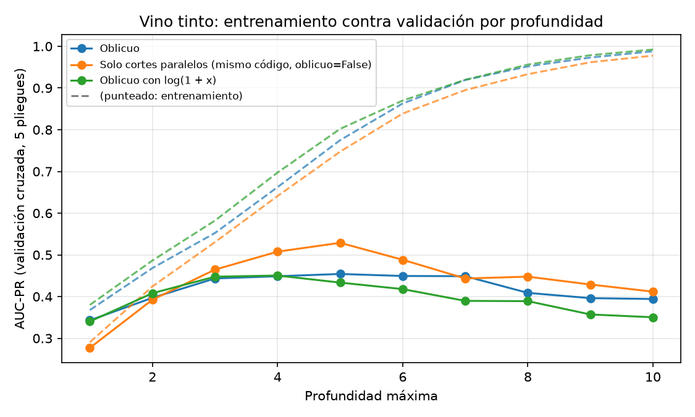

# Problema 2: Árboles que cortan en diagonal

**Owen Adiel Solis Zatarain** · Expediente `223201053` · $a = 3$, $b = 5$ · semilla `223201053`

Con estos parámetros:
- Los datos reales son de **vino tinto** ($a \bmod 4 = 3$): `winequality-red.csv` del UCI Machine Learning Repository, con clase 1 si la calidad es 7 o más.
- El ángulo de rotación del inciso (b) es $10 + 5b = 35°$.

Todo el código está en [`problema_2.ipynb`](problema_2.ipynb). Los datos se descargan desde el propio notebook y no se guardan en el repositorio.

## Cómo reproducir

Desde la raíz del repositorio, con [uv](https://docs.astral.sh/uv/) instalado:

```bash
uv sync
uv run --with jupyter jupyter nbconvert --to notebook --execute --inplace problema-2/problema_2.ipynb
```

El notebook tarda 1–2 minutos y guarda las gráficas en `problema-2/figuras/`. En Windows, joblib puede imprimir avisos `KeyError` al limpiar sus archivos temporales; son inofensivos y no afectan los resultados.

## (a) El árbol oblicuo

La clase `ArbolOblicuo` hereda de `ClassifierMixin` y `BaseEstimator` (en ese orden, para que `scikit-learn` la reconozca como clasificador) y tiene los métodos `fit`, `predict` y `predict_proba`. En cada nodo hace lo siguiente:

1. Calcula la dirección de Fisher $w = S_W^{-1}(m_1 - m_0)$ con los datos que llegan al nodo, proyecta los puntos y elige el umbral con el índice de Gini.
2. Calcula también el mejor corte paralelo a cada eje.
3. Se queda con el corte de menor Gini.

Si $S_W$ no es invertible (alguna variable es constante, o el número de condición de $S_W$ normalizada pasa de $10^{10}$), ese nodo solo usa cortes paralelos.

**Prueba automática:** con los seis puntos de la teoría (b), el código encuentra $w = (2, -2)$, exactamente lo que dio el cálculo a mano, con umbral 0 y sin errores.

## (b) Girar y transformar

Exactitud con validación cruzada de 5 pliegues, sobre 1,000 puntos uniformes en $[-1, 1]^2$ con clase 1 si $x_1 > 0.2$:

| Datos | Modelo | Prof. 1 | Prof. 2 | Prof. 4 | Prof. 8 |
| :--- | :--- | :---: | :---: | :---: | :---: |
| Sin girar | Los tres modelos | 1.000 | 1.000 | 1.000 | 1.000 |
| Girados 35° | Árbol oblicuo | **1.000** | **1.000** | **1.000** | **1.000** |
| Girados 35° | Árbol de sklearn | 0.817 | 0.906 | 0.960 | 0.981 |
| Girados 35° | Bosque aleatorio | 0.886 | 0.937 | 0.976 | 0.988 |
| $x_1 \mapsto e^{3x_1}$ | Los tres modelos | 1.000 | 1.000 | 1.000 | 1.000 |



**Conclusión.**
- **Rotación:** al girar los datos, el árbol de `scikit-learn` necesita una escalera de cortes para aproximar la frontera inclinada. El árbol oblicuo la resuelve con un solo corte, porque sus cortes no cambian al girar los datos (teoría (d)).
- **Exponencial en los árboles normales:** con $e^{3x_1}$ nadie cambia. Para el árbol de `scikit-learn` y el bosque es lo esperado, porque la exponencial es creciente.
- **Exponencial en el árbol oblicuo:** podría haber cambiado, porque la exponencial no es lineal. No cambia porque la frontera sigue siendo una línea vertical, y nuestro árbol compara contra el corte paralelo y elige ese.

## (c) Vino tinto

1,599 vinos con 11 variables. Solo 217 (13.6 %) tienen calidad ≥ 7.

- **Métrica:** AUC-PR como principal (su valor de azar es 0.136) y AUC-ROC como complemento.
- **Profundidad:** se elige con **validación cruzada anidada**, con 5 pliegues externos para evaluar y 5 internos para elegir la profundidad de 1 a 10 usando solo el entrenamiento.

| Modelo | AUC-PR | AUC-ROC | Profundidades elegidas | Hojas por árbol | Tiempo de entrenamiento |
| :--- | :---: | :---: | :---: | :---: | :---: |
| Árbol oblicuo | 0.435 ± 0.031 | 0.837 ± 0.040 | 4, 3, 2, 5, 3 | 11.6 | 0.005 s |
| Árbol de sklearn | 0.503 ± 0.076 | 0.834 ± 0.035 | 5, 4, 4, 3, 4 | 17.2 | 0.002 s |
| Bosque aleatorio (200 árboles) | **0.744** ± 0.036 | **0.929** ± 0.009 | 10, 10, 9, 10, 10 | 88.8 | 0.20 s |
| Bagging de 50 árboles oblicuos | 0.737 ± 0.054 | 0.923 ± 0.013 | 10, 10, 9, 10, 9 | 55.1 | 0.19 s |



**Conclusión.**
- **Árboles solos:** el árbol oblicuo **empata** con el de `scikit-learn` en AUC-ROC, con menos hojas, pero **pierde** en AUC-PR, la métrica que importa con clases desbalanceadas.
- **Ensambles:** son los mejores por mucho, y el bagging de árboles oblicuos queda prácticamente empatado con el bosque aleatorio.

## (d) Cuándo vale la pena

**Hipótesis:** el árbol oblicuo pierde por **varianza**. Cada corte oblicuo estima 11 pesos, y en los nodos profundos quedan pocos vinos buenos.

**Hipótesis alternativa:** las colas largas de algunas variables distorsionan la dirección de Fisher.

**Experimento:** comparamos el AUC-PR de entrenamiento y de validación por profundidad entre el árbol oblicuo, el mismo código con `oblicuo=False` y el oblicuo con $\log(1 + x)$.



**Resultados.**
- **Entrenamiento:** el árbol oblicuo siempre ajusta **mejor** que el paralelo.
- **Validación:** desde profundidad 3 el oblicuo generaliza **peor**, con 0.454 contra 0.529 en profundidad 5. Es sobreajuste.
- **Profundidad 1–2:** el oblicuo **gana** (0.343 contra 0.277 en profundidad 1), porque en la raíz hay muchos datos y la dirección está bien estimada.
- **Logaritmo:** no ayuda, así que la hipótesis alternativa se descarta.
- **Bagging:** reduce la varianza y sube al árbol oblicuo de 0.435 a 0.737.
- **Validación del código:** nuestro árbol con `oblicuo=False` reproduce al de `scikit-learn`.

**Cuándo gana el árbol oblicuo:**
- Cuando la frontera es una combinación lineal de las variables, como en los datos girados.
- Cuando hay suficientes datos por nodo para estimar la dirección.

**Cuándo pierde:**
- Cuando la frontera depende de umbrales en variables individuales.
- Cuando hay pocos datos de la clase minoritaria en los nodos profundos, o muchas variables irrelevantes.

En esos casos conviene usarlo dentro de un ensamble, o limitar su profundidad.
